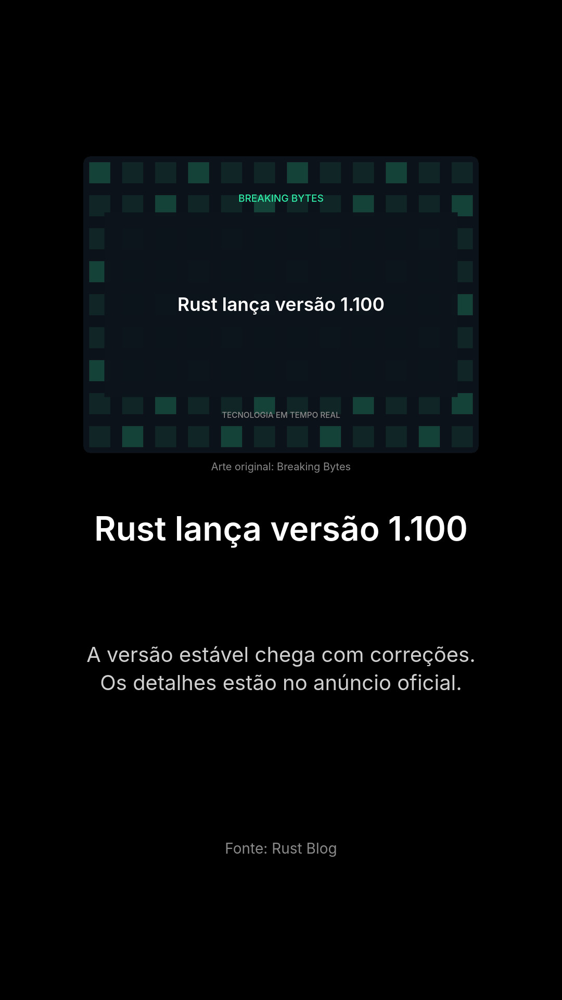

# Breaking Bytes

Pipeline de notícias de tecnologia para Instagram Stories, escrito em Rust a
partir do [blueprint](docs/blueprint.pdf). Um binário, doze crates, Postgres com
outbox, captura, verificação, redação, renderização e publicação reconciliada.
O padrão é `dry_run=true`: simulações nunca recebem um ID de mídia real.

As fases 1–6 têm implementação e testes; o empacotamento operacional da fase 6
está na verificação final. **Não existe aceite de produção ou implantação real
nesta entrega.** Credenciais, corpus real, observações de 24/48/72 horas e os SLOs
ainda exigem validação no destino. [Matriz de requisitos](docs/requirements.md),
[relatórios](docs/reports/phase-6.md), [benchmarks](docs/reports/benchmarks.md) e
[decisões](docs/adr/001-fundacao.md) registram evidências e desvios.

## Executar localmente

Requer Rust 1.100.0, Docker, Postgres 16/pgvector 0.8.2 e cargo-nextest 0.9.152.
As versões diretas e Cargo.lock são fixos. Segredos vêm somente do ambiente;
as referências `env:NOME` do TOML nunca contêm valores secretos.

Configure `DATABASE_URL` e `ADMIN_TOKEN` por seu provedor de segredos. Para o
ambiente local, use uma conexão do Postgres descartável; o token administrativo
precisa de pelo menos 32 bytes aleatórios. Execute:

```sh
cargo run --locked --bin stories-tech -- --migrate
cargo run --locked --bin stories-tech
curl --fail http://127.0.0.1:8080/health/live
curl --fail http://127.0.0.1:8080/health/ready
```

`config/exemplo.toml` e `config/sources.toml` são os padrões. `STORIES_CONFIG` e
`STORIES_SOURCES` selecionam outros arquivos; `STORIES__SECAO__CAMPO` sobrescreve
campos. Arquivo desconhecido/inválido impede inicialização. A coleta e o LLM
começam desativados. Ative `STORIES__COLLECTION__ENABLED=true` e
`STORIES__LLM__ENABLED=true`, com `LLM_API_KEY`, mantendo dry-run. O pipeline
confirma na origem, redige, checa independentemente, gera o JPEG e registra uma
simulação durável. Falta de evidência ou erro de provedor não libera publicação.

O cliente de fontes valida o DNS usado pela conexão, redes públicas, robots,
redirecionamentos, bytes e deadlines. Recusa proxies de ambiente que impedem
assegurar essa validação. Use uma VPS/rota compatível; não contorne o proxy de
um ambiente gerenciado. SEC exige contato real no User-Agent. Cadastre origem
editorial (`origin_group`) para N2; domínios diferentes não provam independência.

## Docker e papéis do banco

Forneça por ambiente os nomes de `.env.example`; o arquivo contém somente nomes
e comentários. O Compose não precisa gravar segredos em arquivo. Antes de usar
produção, inicialize os papéis conforme [backups.md](docs/backups.md):

```sh
docker compose -f deploy/docker-compose.yml build migrate
docker compose -f deploy/docker-compose.yml up -d postgres
docker compose -f deploy/bootstrap-compose.yml run --rm provision
```

O bootstrap recebe a conexão administrativa e senhas hexadecimais distintas.
Depois use `stories_runtime` em DATABASE_URL e `stories_owner` em
MIGRATION_DATABASE_URL; o app não recebe a conexão administrativa. O bootstrap
não substitui migrations: `migrate` termina antes de iniciar o serviço.

```sh
docker compose -f deploy/docker-compose.yml up -d --wait
```

A imagem é não root, sistema de arquivos somente leitura, com volume para JPEGs,
limites de CPU/memória, rotação de logs e shutdown gracioso. O PostgreSQL não
publica porta no host; a API publica somente em 127.0.0.1:8080. Leia o
[runbook](docs/runbook.md) antes de operar volumes, restauração ou atualização.

## Story, editorial e deduplicação



Template 1080×1920, JPEG90, preto, Inter embutida, margens e tipografia do
blueprint. Texto nunca é truncado: redução limitada a 10%, depois reescrita,
respeitando o orçamento global de duas tentativas. Seis referências visuais são
comparadas por pixels. O exemplo é sintético e dispensa banco/rede/credenciais:

```sh
cargo run --locked --bin stories-tech -- --render-example artifacts/example.jpg
```

Imagens externas exigem revisão, domínio, licença, crédito e hash no manifesto.
Sem imagem elegível, usa-se arte tipográfica original. Não há detector automático
de marca d'água/relevância validado; [ADR-009](docs/adr/009-imagens-renderizacao.md).
O agrupamento usa o fallback autorizado `hash_entities`, sem embeddings
simulados; [ADR-005](docs/adr/005-deduplicacao.md). Paráfrases e qualidade semântica
precisam de avaliação real. WebSub e conectores sociais licenciados adicionais
não estão implementados; fontes suportadas e polling estão em
[ADR-006](docs/adr/006-coleta.md).

O corpus editorial incluído é sintético, com oito casos. Para checá-lo com a
chave configurada, usando chamadas cobradas e sem publicar:

```sh
cargo run --locked --bin stories-tech -- --evaluate-editorial crates/editorial/tests/fixtures/evaluation.json artifacts/editorial-report.json
```

Esse comando não substitui corpus real nem revisão humana de redações livres.
Conteúdo de matérias segue como dado separado do sistema; schema, números,
nomes, evidências literais e segunda checagem bloqueiam saídas inconsistentes.

## Publicação e operação

Leia [publicação](docs/publication.md), [tokens](docs/tokens.md),
[controles](docs/operations.md), [observabilidade](docs/observability.md) e
[backups](docs/backups.md). O cliente consulta cota, sobe ao R2, persiste intenção,
cria container STORIES, espera FINISHED e persiste a barreira antes do publish.
Uma resposta perdida exige reconciliação; associação ambígua conserva a intenção
em `uncertain`/`published_unresolved` e exige prova atestada pelo operador.
UNIQUE local não fornece uma transação exatamente uma vez com a API da Meta.
O teste de caos usa SIGKILL real e API de contrato, com um POST/efeito preservado.

`GET /admin/status`, `GET /admin/stats`, blocklist, resolução e
`PUT /admin/pause` exigem Bearer ADMIN_TOKEN; pausa é persistida com auditoria.
`/metrics` deve permanecer privado. Caddy opcional expõe somente rotas previstas;
Grafana e Prometheus têm bind local. A reconsulta/correção é optativa, com janela
24/72 horas, e usa novamente verificação, redação e orçamento.

## Verificar

```sh
cargo fmt --check
cargo clippy --workspace --all-targets --all-features --locked -- -D warnings
cargo nextest run --workspace --all-features --locked
BACKUP_INTEGRATION=1 python3 -m unittest discover -s deploy/backup -p test_backup.py -v
python3 -m unittest discover -s tools -p 'test_*.py' -v
```

Docker é obrigatório: integração usa Postgres/pgvector reais. Contratos HTTP,
propriedades, snapshots, leases, concorrência, privilégios e caos não são
ignorados. CI inclui cobertura de domínio >=80%, benchmarks, fuzz dos parsers,
cargo-deny, auditoria do binário com SBOM e Trivy das imagens próprias.
Três avisos de manutenção têm exceções exatas até 17/12/2026, com validação da
fonte oficial e revisão obrigatória; nenhum CVE recebeu exceção.
[ADR-017](docs/adr/017-seguranca-dependencias.md) e
[ADR-018](docs/adr/018-auditoria-do-binario-e-backup-minimo.md) explicam o escopo.
